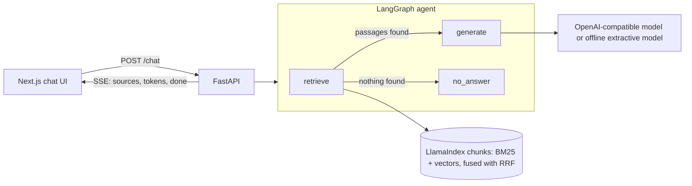

# Agentic RAG Platform

[](https://github.com/Siddharth-DWT/agentic-rag-platform/actions/workflows/ci.yml)
[](LICENSE)

An open reference app for retrieval-augmented generation with an agent in the loop. Ask a question, watch the sources arrive, then watch the answer stream in with citations.

It is built from the libraries production AI teams use: a **LangGraph** agent, **LlamaIndex** chunking with hybrid keyword and vector retrieval, a **FastAPI** server that streams over server-sent events, and a **Next.js** chat UI. It runs fully offline with no API keys; set `OPENAI_API_KEY` to answer with a real model.

## How it works



1. **Ingest.** Documents are split into overlapping chunks with LlamaIndex's `SentenceSplitter`, indexed with BM25 and, when an embedding model is configured, embedded.
2. **Retrieve.** The agent's `retrieve` node runs keyword search (BM25) and vector search side by side and merges the two rankings with reciprocal rank fusion. It immediately streams the best chunks to the UI as sources, each labelled with how it matched.
3. **Route.** A conditional edge sends the run to `generate`, or to `no_answer` when nothing relevant was found, so the model is never asked to answer from nothing.
4. **Generate.** The answer streams token by token, citing sources as `[1]`, `[2]`. Tokens travel on LangGraph's `custom` stream, so the browser sees them while the graph is still running.

## Hybrid retrieval

Keyword and vector search fail in opposite ways, so the app runs both.

| | Finds | Misses |
| --- | --- | --- |
| **BM25 (keyword)** | exact names, codes, rare terms | the same idea in different words |
| **Vector (embeddings)** | paraphrases and synonyms | exact identifiers, very rare terms |

The two rankings are merged with **reciprocal rank fusion**: each list adds `1 / (60 + rank)` for every chunk it returns. RRF uses ranks only, so BM25 scores and cosine similarities never have to be put on one scale, and a chunk that both searches rank highly comes first. Vector matches below a similarity floor are dropped, so an unrelated question still gets "not found" instead of the least-bad chunk.

Without an API key the app runs keyword-only; `/health` reports `"retrieval": "bm25"` or `"hybrid"`.

## Quick start

**Docker**

```bash
docker compose up --build
```

Open http://localhost:3000. The backend loads three sample documents (RAG, MCP and LangGraph) so you can ask questions straight away.

**Local**

```bash
# backend
cd backend
python -m venv .venv && source .venv/bin/activate   # Windows: .venv\Scripts\activate
pip install -r requirements-dev.txt
uvicorn app.main:app --reload

# frontend, in a second terminal
cd frontend
npm install
npm run dev
```

**Use a real model.** Copy `.env.example` to `.env` and set `OPENAI_API_KEY`. This also switches on hybrid retrieval. Any OpenAI-compatible endpoint works through `OPENAI_BASE_URL`, including a local Ollama or vLLM server.

## API

| Method | Path | What it does |
| --- | --- | --- |
| `GET` | `/health` | Status, the model in use and the retrieval mode |
| `GET` | `/documents` | Documents in the index, with chunk counts |
| `POST` | `/documents` | Add a document: `{"title": "...", "text": "..."}` |
| `POST` | `/chat` | Ask a question: `{"question": "..."}`. Streams `sources`, `token` and `done` events |

```bash
curl -N -X POST localhost:8000/chat -H 'Content-Type: application/json' \
  -d '{"question": "How does an MCP server check a token?"}'
```

## Project layout

```
backend/
  app/retrieval.py   chunking, BM25 + vector search, rank fusion
  app/agent.py       the LangGraph graph
  app/llm.py         OpenAI-compatible model and offline fallback
  app/main.py        FastAPI app and SSE streaming
  data/              sample documents
  tests/             pytest suite, runs offline
frontend/            Next.js chat UI
```

## Roadmap

- [x] LangGraph agent with conditional routing and streamed answers
- [x] LlamaIndex chunking with BM25 retrieval
- [x] Next.js chat UI with live sources and citations
- [x] Offline test suite and CI
- [x] Hybrid retrieval: vector search alongside BM25, merged with reciprocal rank fusion
- [ ] Reranking with a cross-encoder
- [ ] Document ingestion from PDFs, Office files and web pages
- [ ] Conversation memory with a LangGraph checkpointer
- [ ] Human-in-the-loop approval for tool calls
- [ ] The agent's tools exposed as a remote MCP server with OAuth
- [ ] Tracing with Langfuse
- [ ] Retrieval and answer-quality evaluation running in CI
- [ ] Chat UI on the Vercel AI SDK

## License

MIT
